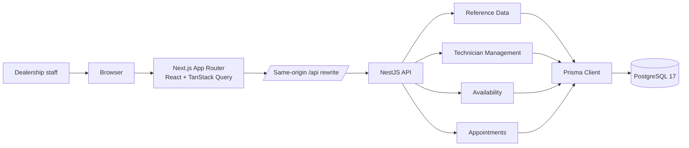
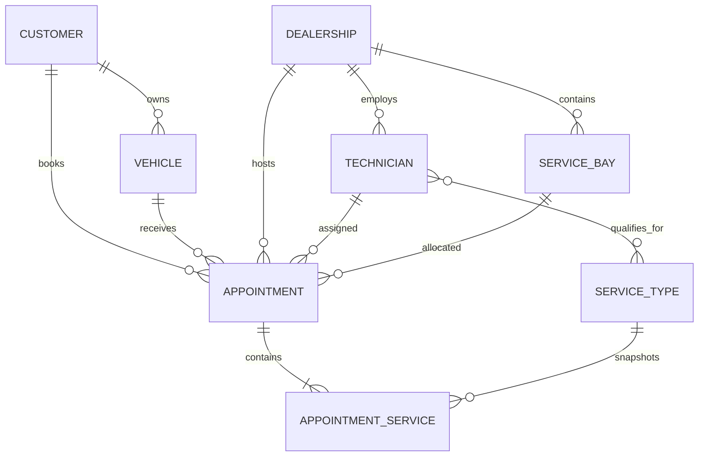
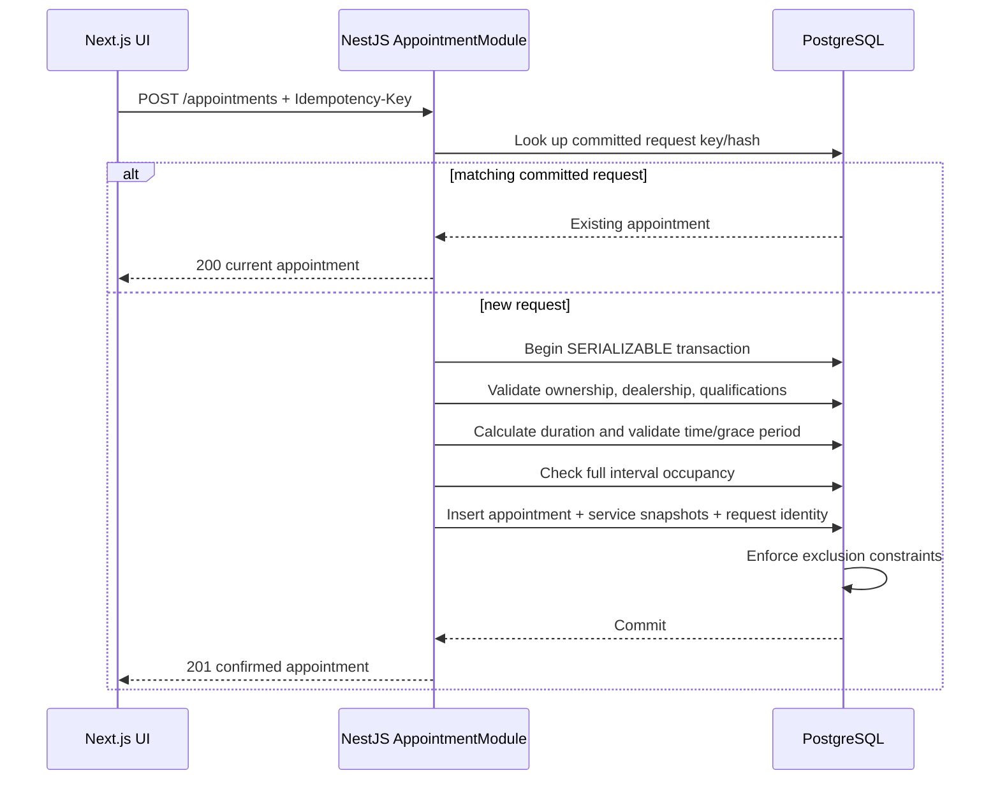

# Unified Service Scheduler — System Design

**Scenario:** A — Service Scheduler  
**Updated:** 30 October 2026  
**Status:** Implemented assessment solution  
**Requirements:** [PRD v1.5](PRD.md)  
**Interface:** [OpenAPI](openapi.yaml)

## 1. Purpose and scope

USS lets dealership staff create and manage resource-constrained vehicle service appointments. One appointment contains one customer, one vehicle, one dealership, one technician, one bay, and one or more sequential services. The technician must be qualified for every selected service, and the vehicle, technician, and bay must be free for the full combined duration.

Implemented supporting administration includes customers, service types, technicians, and Technician–ServiceType qualifications. Authentication, rescheduling, payments, notifications, reporting, individual shifts/leave, and production multi-tenancy remain outside scope.

## 2. Architecture



This is a modular monolith. Splitting a short assessment into distributed services would add deployment and consistency cost without improving the demonstrated booking invariant.

## 3. Component responsibilities

| Component | Responsibility |
|---|---|
| Next.js frontend | Staff booking workspace, appointment table, customer/service/technician administration, loading/error/empty states, and same-origin backend access. |
| TanStack Query | Browser-side server state, request cancellation, cache invalidation after mutations, and reusable query keys. |
| React Hook Form + Zod | Interactive form state and immediate client feedback. Backend validation remains authoritative. |
| NestJS common layer | Global validation, consistent error envelopes, request correlation IDs, demo staff context, and Swagger UI. |
| ReferenceDataModule | Customer lookup/create/update, customer vehicles, dealerships, and service-type management. |
| TechnicianModule | Technician list/create/update and idempotent qualification attach/detach. |
| AvailabilityModule | Read-only eligible starts and resource alternatives for a vehicle, dealership, date, and service set. |
| AppointmentModule | Booking/replay, list/detail reads, cancellation, completion, and lifecycle rules. |
| Prisma | Typed persistence and transaction boundary. |
| PostgreSQL | Durable records, relational integrity, serializable transactions, unique request identity, and exclusion constraints preventing overlaps. |

The browser never decides whether a resource is valid or available. It displays backend results and sends the selected IDs for final validation.

## 4. Main data model



Important persistence rules:

- Customer phone and normalized vehicle registration are unique.
- A technician name is unique within a dealership.
- Technician qualifications are direct join rows; there is no separate Skill entity.
- Appointment services store name and duration snapshots, so later service-type edits do not rewrite history.
- Composite foreign keys enforce that the selected vehicle belongs to the customer and that technician/bay belong to the appointment dealership.
- Appointment request keys are unique and retained for the appointment lifetime.

## 5. Availability flow

1. Staff selects a vehicle, dealership, one or more services, and a Vietnam calendar date.
2. The frontend calls `GET /availability`.
3. The backend loads the referenced data and sums fixed service durations.
4. It finds technicians at the dealership whose qualification set contains every selected service.
5. It generates 30-minute starts between 08:00 and 17:00 Asia/Ho_Chi_Minh.
6. It removes past starts, starts ending after close, vehicle conflicts across dealerships, and technician/bay conflicts.
7. Each remaining slot returns all eligible technicians and bays plus the first IDs as stable suggestions.

Availability is a read-only snapshot and never reserves a resource. The response uses `Cache-Control: no-store`.

## 6. Booking and replay flow



The client generates a UUID request key for a booking intent. The server canonicalizes UUIDs, sorts service IDs, normalizes the timestamp, and stores a SHA-256 request hash.

- Same key and same content returns the existing appointment, including its current cancelled/completed state.
- Same key and different content returns `IDEMPOTENCY_KEY_REUSED`.
- A new request is allowed until scheduled start + 15 minutes inclusive.
- The selected technician and bay are never silently replaced.
- Serializable conflicts are retried once; the committed key is checked again after errors.

## 7. Double-booking protection

Application checks provide useful conflict errors, but PostgreSQL is the correctness boundary. The migration enables `btree_gist` and defines three exclusion constraints:

```text
(technician_id, tstzrange(scheduled_start, occupancy_end, '[)'))
(service_bay_id, tstzrange(scheduled_start, occupancy_end, '[)'))
(vehicle_id, tstzrange(scheduled_start, occupancy_end, '[)'))
```

Two rows cannot overlap for the same technician, bay, or vehicle. Half-open ranges allow adjacent appointments where one ends exactly when the next begins. Integration tests submit concurrent requests through separate transactions and assert that at most one conflicting allocation commits.

## 8. Lifecycle and effective occupancy

Appointments use `CONFIRMED`, `CANCELLED`, or `COMPLETED`; there is no manual Start action.

| State | Effective `occupancy_end` |
|---|---|
| CONFIRMED | Scheduled end |
| CANCELLED before start | Scheduled start (empty interval) |
| CANCELLED after start | Cancellation time, capped to scheduled interval |
| COMPLETED early | Actual completion time |
| COMPLETED at/after scheduled end | Scheduled end |

Cancellation is idempotent. Completion before start or from CANCELLED is rejected, and repeated completion returns “Appointment already completed.” Row locking serializes concurrent cancel/complete attempts. Existing confirmed appointments remain valid if a technician qualification is later removed.

## 9. HTTP interface

| Area | Operations |
|---|---|
| Health | Readiness and demo staff identity |
| Customers | Capped prefix lookup; create/update; list/create owned vehicles |
| Service types | List/create/update fixed-duration services |
| Technicians | List/filter; create/update; attach/detach qualifications |
| Availability | Eligible starts, alternatives, and duration summary |
| Appointments | Create/replay, list/search/filter/page, detail |
| Lifecycle | Cancel and complete |

The checked-in [OpenAPI contract](openapi.yaml) is the detailed interface source. Runtime Swagger UI is available at `/docs`. Backend paths do not include the frontend `/api` proxy prefix.

## 10. Technology choices

| Technology | Reason and trade-off |
|---|---|
| NestJS + TypeScript | Clear modules, DTO validation, dependency injection, and Swagger support. More ceremony than a minimal HTTP framework, but useful for an assessment design discussion. |
| Next.js App Router | Fast implementation of separate staff pages with a server/client component boundary and same-origin proxy. |
| shadcn/Base UI + Tailwind | Accessible primitives and quick functional UI without a custom design system. |
| TanStack Query | Server-state caching and mutation invalidation without introducing Redux/Zustand. |
| PostgreSQL 17 | Transactions, range types, exclusion constraints, and relational integrity directly fit resource scheduling. |
| Prisma 7 | Typed access and repeatable migrations; reviewed SQL supplements features Prisma schema cannot express. |
| Docker Compose | Reproducible local development/test databases; it is not a production deployment design. |
| Vitest + Supertest | Fast unit/HTTP testing and real-PostgreSQL integration coverage. |

The Compose definition is colocated with the backend at `apps/server/compose.yaml`. Its sibling `.env` supplies both Compose database variables and the backend `DATABASE_URL`; `.env.test` supplies the guarded test connection URL.

## 11. Observability

Implemented:

- Every response carries `X-Request-Id`; valid incoming IDs are preserved.
- Errors use a consistent envelope: status, code, message, and request ID.
- Standard NestJS `Logger` records structured events for booking creation/replay, cancellation, completion, customer/vehicle/service changes, technician changes, and qualification changes.
- Unexpected server errors log method, path, status, code, and request ID without logging booking payloads or customer details.
- `GET /health` checks API/database readiness.

Not implemented for this local demo: metrics exporter, tracing backend, dashboards, alerts, or fixed SLOs. A production version would add low-cardinality booking outcome/latency/lock metrics and OpenTelemetry spans; customer or appointment IDs should not become metric labels.

## 12. Reliability, performance, and security boundaries

- PostgreSQL persistence survives application restarts; the local named volume is not a backup.
- Database unavailability fails booking explicitly; the application does not queue an unconfirmed write.
- Customer lookup is capped at 20 and uses prefix indexes for name, normalized phone, and normalized registration.
- Appointment list defaults to 20 rows and stable scheduled-start/ID ordering.
- Availability batches data per request and generates at most one operating day in memory.
- No authentication or authorization exists. The app is a local single-organization assessment demo, not an internet-ready service.
- No fixed throughput target was supplied; load measurement has not been performed.

## 13. Verification evidence

Recorded on 30 October 2026:

| Check | Evidence |
|---|---|
| Unit behavior | 19 backend unit tests passing |
| HTTP application behavior | 3 backend e2e tests passing |
| HTTP/database behavior | 32 integration tests across availability, booking/replay, reads, lifecycle, reference data, and technician management |
| Concurrency | Concurrent same-key booking, conflicting allocation, and cancel-versus-complete tests pass against PostgreSQL |
| Static checks | Backend/frontend lint and TypeScript checks pass |
| Packaging | NestJS and Next.js production builds pass |
| Contract syntax | OpenAPI YAML parses successfully |

Known verification gaps: no automated frontend test suite, no measured load test, and no recorded fresh-checkout rehearsal on another machine.

## 14. GenAI use

GenAI was used as a collaborator, not the product decision-maker.

Assistance included:

- Extracting the assessment obligations and turning owner decisions into explicit requirements.
- Proposing architecture, schema, API, concurrency, and test approaches.
- Implementing and refactoring backend/frontend code under owner direction.
- Diagnosing migration, validation, UX, and workflow issues.
- Maintaining OpenAPI, tests, README, and design documents.

The owner selected Scenario A and the technology stack, then corrected or rejected AI proposals. Examples include using direct Technician–ServiceType links instead of a Skill entity, removing login and a manual Start action, changing from one service to multiple services, setting the 15-minute confirmation rule, preferring staff-first tables/search over decorative wizard UI, and replacing a confirmation page with loading/success toasts.

AI-produced code and documents were checked with type checks, linting, builds, unit tests, and real-PostgreSQL integration tests. Exact collaboration history and evidence boundaries are in [AI collaboration evidence](ai-collaboration.md).
